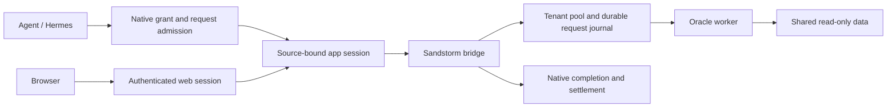

# Oracle appliance: checkpoint and design review

The signed v7 appliance works as a bounded Oracle service. It has not completed
the hosted agent, browser and restart journey. Both build VMs were deliberately
retired; detached volumes exist but their contents are unverified. Source rescue
bundles are not controller-world backups. No qualification is running on those
deleted hosts, and no replacement host was created for this review.

## What works and what remains

| Surface | Evidence and limit |
| --- | --- |
| Runtime and data | Signed ~97 MB runtime; ~15 GB shared read-only dataset. Archive/signature verified. Data stays outside the SPK. |
| Tenant isolation and replay | Real Linux run: 32 workspaces, one observed Engine, peak cgroup memory ~716 MiB under 2 GiB. Exact retries, conflict refusal and replay after restart pass. This is adapter qualification. |
| Mini admission | Native session and lifetime grant, route migration, STOP and successor START passed in the retained runs. The complete receiving journey did not. |
| Hermes | Enrollment and signed readiness passed. A completed deterministic provider turn took a generic branch and made no Oracle call; native receiving then encountered codec identity mismatches. Source fixes are integrated, but no passing Oracle agent answer is claimed. |
| Browser | Actual shipped HTML inspected at desktop and mobile sizes using synthetic HTTP fixtures. All 27 existing interaction checks pass. No hosted authentication/browser pass is claimed. |
| Performance | Repeated retained-Store inspection is much faster; cold history verification still takes minutes in recorded runs. One-worker tenant switching still restarts Oracle. Neither is ready to call fast hosting. |

The request path crosses distinct boundaries:

Oracle finishing an answer, the adapter retaining its bytes, and Mini receiving
and settling that call are different events. A checkpoint must identify which
event completed; a green check for one cannot substitute for the others.

## Structural corrections before another long journey

1. **Use one identity through all views.** Cell/sequence identify the Hermes
   request. Native local indices and merged transcript positions do not. The
   provider and driver repairs now join canonical identities and consult native
   completion state; preserve this rule in consumer fixtures.
2. **Resolve runtime selection once.** The client selected the installed HOME
   Host via `MINI_LOCAL_HOST`, while the receiving proof expected the BASE copy.
   Both now use the shared Host selector. Completion accepts the exact known
   stateless codec pair only after validating selected/configured binary
   equivalence and process custody. Unknown descendants still refuse.
3. **Treat lifecycle state as a contract.** Readiness, active work, durable
   completion, receipt and STOP need explicit producer/consumer cases. Inspect
   actual serialized outputs and the state transitions before spending another
   run discovering fixture assumptions. A generic fixture reply is not evidence
   that Oracle ran.
4. **Separate request latency from deployment work.** Cold Store recomputation,
   repeated whole-image reads and tenant Engine construction are different costs.
   Address them at their owners; increasing deadlines merely hides them. The
   latest codec proof hashes executable equivalence once per proof, then checks
   stable file identity/metadata during repeated observations.

The final selector composition (`70381a736`) passed a bounded Linux hbox check:
one SDK selection test, 14 cgroup tests and 15 quiescence tests, plus release-mode
`cargo check` of Mini. One existing systemd-dependent cgroup fixture was ignored.
The first compile attempt exposed a feature-gated module; `7470f534a` moved the
std-only selector into its own module and the corrected check passed. This
establishes source composition, not a new runtime release or native receiving
pass. The exact log is retained in root's ignored scratch directory.

## Hosting and the browser need another design pass

The one-worker pool bounds RAM by stopping an idle tenant's Engine before
constructing the next tenant's. It does not multiplex many live conversations
inside one warm Engine. Alternating tenants therefore pay startup and stale
conversation resets; the measured 32-tenant memory result is not a low-latency
concurrency result. A useful next experiment is to separate immutable loaded
Oracle state from request/conversation state, beginning with stateless direct
operations. Compare a safe preloaded worker strategy with explicit session state;
do not assume a mutable Engine can simply be shared or forked after threads start.

The browser renders cleanly and preserves exact request bytes while open, but
its initial mobile viewport is mostly explanation and a machine conversation ID.
Operation details are raw JSON, and their tall column leaves a large empty
question panel. Reload discards the page's retry handles despite durable server
results. Improve task-first navigation and schema-based inputs, keep raw evidence
available, and design authenticated recovery of retained requests before calling
this a polished hosted experience. Screenshots are local preview artifacts;
their synthetic replies prove neither Oracle correctness nor Mini admission.

Converge on shared contracts and the hot path, then use one coherent build for a
single composed journey: real agent discovery/call, missing-grant refusal,
browser authentication/origin checks, restart/exact retry, and native STOP.
The [overview](oracle-appliance.md) records package behavior and
[ROWS-OWED](ROWS-OWED.md#oracle-appliance) records qualification still owed.
